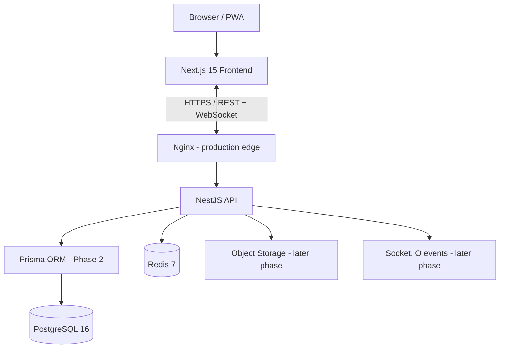

# MedCore HMS

A multi-tenant Hospital Management System scaffold based on the supplied MedCore HMS PRD.

## Phase 1 scope

- pnpm monorepo foundation
- Next.js App Router frontend
- NestJS REST API
- Shared TypeScript package
- PostgreSQL 16 and Redis 7 development infrastructure
- Environment-variable template and Git hygiene
- Health endpoint and initial landing page

Database schema, Prisma models/migrations, authentication, RBAC, and business modules are intentionally implemented in later phases.

## Prerequisites

- Node.js 20 LTS or newer compatible LTS
- pnpm 9
- Git
- Docker Desktop with Docker Compose

Check installations:

```powershell
node --version
pnpm --version
git --version
docker --version
docker compose version
```

## Setup (Windows PowerShell)

1. Extract this folder.
2. Open the extracted `MedCore-HMS-Phase-1` folder in VS Code.
3. Copy environment template:

```powershell
Copy-Item .env.example .env
```

4. Edit `.env` and replace the local database password and JWT placeholders. The JWT values are placeholders only; do not use them in production.
5. Install workspace dependencies:

```powershell
corepack enable
corepack prepare pnpm@9.15.9 --activate
pnpm install
```

6. Start PostgreSQL and Redis:

```powershell
docker compose up -d postgres redis
docker compose ps
```

7. Start frontend and backend in separate VS Code terminals:

```powershell
pnpm dev:frontend
```

```powershell
pnpm dev:backend
```

Frontend: http://localhost:3000  
Backend health: http://localhost:3001/api/v1/health

## Verify

```powershell
pnpm --filter @medcore/frontend build
pnpm --filter @medcore/backend build
```

The API health route should return a JSON response with `status: "ok"`.

## Architecture



## Security and implementation notes

- Never commit `.env`, credentials, JWT secrets, patient data, or real medical records.
- Use invented demo data only.
- The PRD specifies Next.js 15. This scaffold pins the final patched 15.x release, `15.5.28`. The 15.x line has reached end of maintenance; before a production deployment, upgrade to a currently supported Next.js major and re-test compatibility. The PRD's target stack is retained here for project alignment.
- This phase does not claim HIPAA compliance or production readiness. Security controls, tenant isolation, encryption, audit logs, and access guards must be implemented and tested in later phases.

## Completed Phases

- **Phase 1**: Monorepo structure, Next.js 15 frontend, NestJS 11 backend, Docker PostgreSQL 16 & Redis 7 infrastructure, environment configuration, health check.
- **Phase 2**: PostgreSQL data model (3NF), Prisma ORM 6.19.3 configuration, 21 relational models, 17 enums, multi-tenant row-level isolation architecture, migrations, automated seed script, integration test suite, and ER documentation.
- **Phase 3**: Authentication (JWT + refresh token rotation), 9-role RBAC authorization (`RolesGuard`, `@Roles`), multi-tenant hospital security (`TenantGuard` and query-level isolation), test endpoints, comprehensive 22-test automated suite, and complete architectural documentation.

## Authentication, RBAC & Multi-Tenancy (Phase 3)

### Configuration Settings
Authentication and security are configured via `.env`:
```env
# JWT Access Token Configuration (15 minutes)
JWT_ACCESS_SECRET="medcore_jwt_access_super_secret_key_prod_2026_min32chars"
JWT_ACCESS_EXPIRATION="15m"

# Refresh Token Configuration (7 days)
JWT_REFRESH_SECRET="medcore_jwt_refresh_super_secret_key_prod_2026_min32chars"
JWT_REFRESH_EXPIRATION="7d"

# Bcrypt Security Cost
BCRYPT_SALT_ROUNDS="12"
```

### Authentication Endpoints

| Method | Endpoint | Description | Access |
| :--- | :--- | :--- | :--- |
| `POST` | `/api/v1/auth/login` | Authenticate with email/password; returns access + refresh tokens | Public |
| `POST` | `/api/v1/auth/refresh` | Rotate session with opaque refresh token | Public |
| `POST` | `/api/v1/auth/logout` | Revoke session and invalidate refresh token | Bearer Token |
| `GET` | `/api/v1/auth/me` | Fetch sanitized profile of current authenticated user | Bearer Token |

### API Usage Examples (PowerShell)

**1. Login:**
```powershell
$body = @{ email = 'admin.apex@medcore.io'; password = 'DemoPassword@123' } | ConvertTo-Json
$res = Invoke-RestMethod -Uri 'http://localhost:3001/api/v1/auth/login' -Method Post -Body $body -ContentType 'application/json'
$accessToken = $res.data.accessToken
$refreshToken = $res.data.refreshToken
```

**2. Query Authenticated User Profile:**
```powershell
Invoke-RestMethod -Uri 'http://localhost:3001/api/v1/auth/me' -Method Get -Headers @{ Authorization = "Bearer $accessToken" }
```

**3. Refresh Session Token:**
```powershell
$refreshBody = @{ refreshToken = $refreshToken } | ConvertTo-Json
$newRes = Invoke-RestMethod -Uri 'http://localhost:3001/api/v1/auth/refresh' -Method Post -Body $refreshBody -ContentType 'application/json'
```

**4. Logout:**
```powershell
$logoutBody = @{ refreshToken = $newRes.data.refreshToken } | ConvertTo-Json
Invoke-RestMethod -Uri 'http://localhost:3001/api/v1/auth/logout' -Method Post -Body $logoutBody -ContentType 'application/json' -Headers @{ Authorization = "Bearer $($newRes.data.accessToken)" }
```

### Running Test Suites (PowerShell)

Run Phase 3 Auth, RBAC & Tenant Security Tests (22 automated tests):
```powershell
pnpm --filter @medcore/backend test:auth
```

Run Phase 2 Database & Referential Integrity Tests (17 automated tests):
```powershell
pnpm --filter @medcore/backend test:db
```

### Documentation
- [Authentication Architecture & Lifecycle](file:///docs/authentication.md)
- [RBAC Permissions & Nine-Role Matrix](file:///docs/rbac-permissions.md)
- [Multi-Tenant Architecture & Isolation Strategy](file:///docs/multi-tenancy.md)
- [Backend Security Architecture & Threat Mitigation](file:///docs/security-architecture.md)
- [Database Architecture](file:///docs/database-architecture.md)
- [Design Decisions](file:///docs/database-decisions.md)
- [Entity Relationship Diagram (ERD)](file:///docs/er-diagram.md)

## Next Phase

Phase 4: Core Hospital Management Modules (Patient Registration & EMR, Appointment Scheduling, and Departmental Clinical Workflows).

