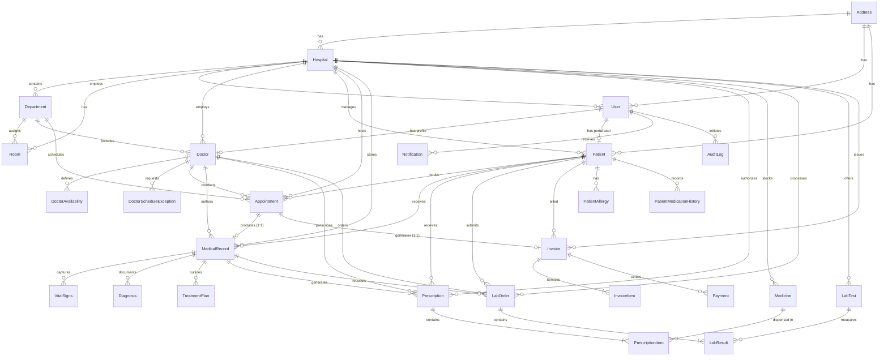

# MedCore HMS — Entity Relationship Diagram (ERD)

This diagram visualizes the complete, normalized schema implemented in `backend/prisma/schema.prisma`.

---

## Detailed Model Relational Cardinality

| Source Model | Relationship | Target Model | Cardinality | Notes / Foreign Key |
| :--- | :--- | :--- | :--- | :--- |
| `Hospital` | 1 to Many | `Department` | `1 : N` | `Department.hospitalId -> Hospital.id` (Cascade) |
| `Hospital` | 1 to Many | `Room` | `1 : N` | `Room.hospitalId -> Hospital.id` (Cascade) |
| `Hospital` | 1 to Many | `User` | `1 : N` | `User.hospitalId -> Hospital.id` (Cascade; nullable for Super Admin) |
| `Department` | 1 to Many | `Doctor` | `1 : N` | `Doctor.departmentId -> Department.id` (Restrict) |
| `User` | 1 to 1 | `Doctor` | `1 : 1` | `Doctor.userId -> User.id` (Restrict) |
| `User` | 1 to 1 (opt) | `Patient` | `1 : 0..1`| `Patient.userId -> User.id` (SetNull) |
| `Doctor` | 1 to Many | `Appointment` | `1 : N` | `Appointment.doctorId -> Doctor.id` (Restrict) |
| `Patient` | 1 to Many | `Appointment` | `1 : N` | `Appointment.patientId -> Patient.id` (Restrict) |
| `Appointment` | 1 to 1 | `MedicalRecord` | `1 : 1` | `MedicalRecord.appointmentId -> Appointment.id` (Restrict) |
| `MedicalRecord` | 1 to Many | `VitalSigns` | `1 : N` | `VitalSigns.medicalRecordId -> MedicalRecord.id` (Cascade) |
| `MedicalRecord` | 1 to Many | `Diagnosis` | `1 : N` | `Diagnosis.medicalRecordId -> MedicalRecord.id` (Cascade) |
| `MedicalRecord` | 1 to Many | `TreatmentPlan` | `1 : N` | `TreatmentPlan.medicalRecordId -> MedicalRecord.id` (Cascade) |
| `Prescription` | 1 to Many | `PrescriptionItem` | `1 : N` | Join table for M:N with `Medicine` |
| `Medicine` | 1 to Many | `PrescriptionItem` | `1 : N` | `PrescriptionItem.medicineId -> Medicine.id` (Restrict) |
| `LabOrder` | 1 to Many | `LabResult` | `1 : N` | `LabResult.labOrderId -> LabOrder.id` (Cascade) |
| `LabTest` | 1 to Many | `LabResult` | `1 : N` | `LabResult.labTestId -> LabTest.id` (Restrict) |
| `Invoice` | 1 to Many | `InvoiceItem` | `1 : N` | `InvoiceItem.invoiceId -> Invoice.id` (Cascade) |
| `Invoice` | 1 to Many | `Payment` | `1 : N` | `Payment.invoiceId -> Invoice.id` (Cascade) |
| `Appointment` | 1 to 1 (opt) | `Invoice` | `1 : 0..1`| `Invoice.appointmentId -> Appointment.id` (SetNull) |
