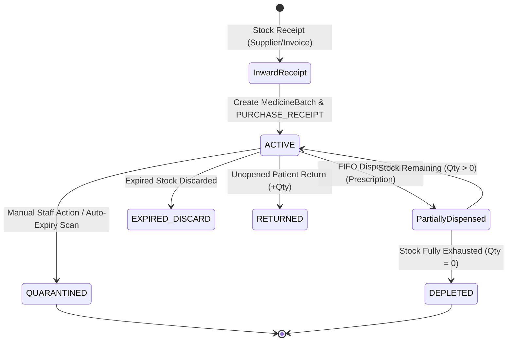

# MedCore HMS — Phase 10: Pharmacy & Inventory Management Completion Report

**Document Status:** Complete  
**Date:** November 4, 2026  
**Phase:** 10 of 15 (Original Roadmap)  
**Corpus / Workspace:** `MedCore-HMS-Phase-1`  

---

## 1. Executive Summary

Phase 10 of MedCore HMS delivers enterprise-grade Pharmacy & Inventory Management to the multi-tenant SaaS platform. Hospital pharmacy operations demand strict FIFO (First-In, First-Out) batch allocation, end-to-end stock traceability, automated expiry monitoring, quarantine isolation, anti-overselling concurrency protection, and zero-trust multi-tenant role enforcement.

During this phase, existing models and services were inspected and enhanced to provide a complete pharmacy inventory management lifecycle without destructive database migrations or resetting active tenant data. All requirements have been implemented, integrated with the Phase 8 prescription engine and BullMQ background workers, and validated with a dedicated 50-test integration suite achieving a 100% pass rate alongside complete regression verification across Phases 2 through 9.

---

## 2. Phase 10 Requirement Checklist

| Requirement | Scope | Status | Notes |
|---|---|---|---|
| **Medicine Catalog** | Full CRUD, Code/SKU, Form, Strength, Manufacturer, Reorder Threshold, Unit Price | **PASS** | Validated, unique per tenant, tenant-isolated |
| **Catalog RBAC** | Modification restricted to Pharmacists & Hospital Admins | **PASS** | Patients, Doctors, Nurses strictly blocked |
| **Medicine Batch Management** | Batch No., Mfg Date, Expiry Date, Quantities, Unit Cost, MRP, Supplier | **PASS** | Strict date validation (`mfgDate < expiryDate`, `expiry > now`) |
| **Stock Receiving** | Inward receipt into new or existing batches with invoice references | **PASS** | Atomic transactions, `PURCHASE_RECEIPT` ledger entry, audit logging |
| **Stock Ledger & Traceability** | Movement history capturing delta, previous stock, new stock, reason, user | **PASS** | Comprehensive query endpoint `GET /pharmacy/movements` |
| **Stock Adjustments & Returns** | Manual inventory count adjustments and unopened patient returns | **PASS** | Mandatory justification (`reason.length >= 3`), no negative stock |
| **FIFO Dispensing Engine** | Oldest non-expired batch consumed first; multi-batch allocation | **PASS** | Orders batches by `expiryDate ASC, mfgDate ASC` |
| **Quarantine & Expiry Isolation** | Expired and quarantined batches excluded from FIFO selection | **PASS** | Excluded via DB query constraints & status flags |
| **Concurrency & Advisory Locking** | Prevent overselling under simultaneous dispensing requests | **PASS** | `pg_advisory_xact_lock(hashtext('dispense_' \|\| medicineId))` |
| **Prescription Integration** | Dispensing pending prescriptions, updating status, recording batch history | **PASS** | Supports partial and complete fulfillment; blocks cancelled Rx |
| **Automated Expiry Monitor** | Nightly BullMQ scan for medicines expiring within 30 days & auto-quarantine | **PASS** | BullMQ schedule `0 0 * * *` with `runExpiryCheck()` |
| **Low-Stock Alerts** | Identification of medicines at or below configured reorder levels | **PASS** | Computed dynamically against active unexpired batches |
| **Multi-Tenant Security & Anti-IDOR**| Strict hospital scoping, patient portal protections, audit logging | **PASS** | Cross-tenant queries and mutations blocked with 403 Forbidden |
| **Frontend Pharmacy Interface** | Catalog, batches, FIFO queue, movements ledger, dispensing history, alerts | **PASS** | Integrated into `frontend/app/pharmacy/page.tsx` |

---

## 3. Existing Functionality Discovered vs Features Implemented

### Features Already Present and Verified:
- **Prisma Schema Foundations:** `Medicine`, `MedicineBatch`, `StockMovement`, and `DispensingRecord` models existed with appropriate enum types (`BatchStatus`: `ACTIVE`, `QUARANTINED`, `EXPIRED`, `DEPLETED`; `StockMovementType`: `PURCHASE_RECEIPT`, `DISPENSED`, `RETURNED`, `EXPIRED_DISCARD`, `ADJUSTMENT`, `QUARANTINED`).
- **Core Advisory Locking:** PostgreSQL transaction advisory locking was already established in `dispensePrescription()`.
- **BullMQ Expiry Monitor Infrastructure:** `ExpiryMonitorService` was already registered with Redis BullMQ queue `pharmacy-expiry-checks`.

### Features Genuinely Missing & Implemented in Phase 10:
1. **Medicine Formulary Details & Mutation API:**
   - Implemented `GET /pharmacy/medicines/:id` with total unexpired active stock computation and `isLowStock` indicator.
   - Implemented `PATCH /pharmacy/medicines/:id` with tenant ownership verification and code collision prevention.
   - Created [update-medicine.dto.ts](../../backend/src/pharmacy/dto/update-medicine.dto.ts) with complete validation rules.
2. **Dedicated Stock Receiving Workflow:**
   - Created [receive-stock.dto.ts](../../backend/src/pharmacy/dto/receive-stock.dto.ts) capturing supplier, invoice reference, batch number, dates, quantity, and pricing.
   - Implemented `POST /pharmacy/receive-stock` supporting receipt into new or existing batches with atomic `PURCHASE_RECEIPT` movements and audit logs.
3. **Comprehensive Inventory Traceability & Ledger:**
   - Implemented `GET /pharmacy/movements` with filtering by `medicineId`, `batchId`, and `StockMovementType`.
   - Implemented `GET /pharmacy/dispensing-records` providing patient, doctor, medicine, batch number, unit price, total price, and dispensing pharmacist details.
4. **Strict Stock Adjustment Validation:**
   - Updated [adjust-stock.dto.ts](../../backend/src/pharmacy/dto/adjust-stock.dto.ts) and `adjustStock()` to enforce mandatory audit justifications (`@MinLength(3)`).
   - Added `AuditLog` recording on all manual stock adjustments and patient returns.
5. **Batch Inspection & Single Batch Query:**
   - Implemented `GET /pharmacy/batches/:id` with anti-IDOR cross-tenant guard.
6. **Frontend Pharmacy Interface Upgrades:**
   - Replaced mock/incomplete payloads with real API bindings.
   - Added SKU code input in Add Medicine modal.
   - Added **Stock Ledger (Movements)** tab and **Dispensing History** tab.
   - Added **Stock Adjustment & Returns** modal with mandatory justification textarea.

---

## 4. Files Created and Modified

### Created Files:
- [backend/src/pharmacy/dto/update-medicine.dto.ts](../../backend/src/pharmacy/dto/update-medicine.dto.ts): DTO for medicine formulary updates.
- [backend/src/pharmacy/dto/receive-stock.dto.ts](../../backend/src/pharmacy/dto/receive-stock.dto.ts): DTO for incoming supplier stock receipt.
- [backend/test/phase10-pharmacy-inventory.test.ts](../../backend/test/phase10-pharmacy-inventory.test.ts): 50-test dedicated integration test suite.
- [phase_10_pharmacy_inventory_management_report.md](../../phase_10_pharmacy_inventory_management_report.md): Phase completion report.

### Modified Files:
- [backend/src/pharmacy/dto/adjust-stock.dto.ts](../../backend/src/pharmacy/dto/adjust-stock.dto.ts): Mandatory reason validation.
- [backend/src/pharmacy/pharmacy.service.ts](../../backend/src/pharmacy/pharmacy.service.ts): Added CRUD, stock receipt, movements ledger, dispensing history, date validations, audit logging.
- [backend/src/pharmacy/pharmacy.controller.ts](../../backend/src/pharmacy/pharmacy.controller.ts): Exposed endpoints for medicine retrieval, updates, stock receiving, movements, and dispensing records.
- [frontend/app/pharmacy/page.tsx](../../frontend/app/pharmacy/page.tsx): Comprehensive UI overhaul supporting all pharmacy tabs, modals, and real-time backend data.
- [backend/package.json](../../backend/package.json): Added `"test:phase10": "tsx test/phase10-pharmacy-inventory.test.ts"`.
- [backend/test/phase9-laboratory-management.test.ts](../../backend/test/phase9-laboratory-management.test.ts): Fixed minor patient model creation typing.

---

## 5. Database Schema & Migration Rules

- **Zero Destructive Changes:** No tables, columns, or relations were dropped or altered destructively.
- **Prisma Schema Validity:** Validated via `npx prisma validate` with 100% compliance.
- **No Migrations Required:** The existing Prisma schema already modeled all required relational tables (`medicines`, `medicine_batches`, `stock_movements`, `dispensing_records`, `prescriptions`, `prescription_items`).

---

## 6. API Endpoints Reference

| Method | Endpoint | Allowed Roles | Description |
|---|---|---|---|
| `POST` | `/api/v1/pharmacy/medicines` | `PHARMACIST`, `HOSPITAL_ADMIN`, `SUPER_ADMIN` | Create new formulary medicine |
| `GET` | `/api/v1/pharmacy/medicines` | `PHARMACIST`, `DOCTOR`, `HOSPITAL_ADMIN`, `NURSE`, `SUPER_ADMIN` | List formulary medicines with stock & search |
| `GET` | `/api/v1/pharmacy/medicines/:id` | `PHARMACIST`, `DOCTOR`, `HOSPITAL_ADMIN`, `NURSE`, `SUPER_ADMIN` | Get single medicine with batch breakdown |
| `PATCH`| `/api/v1/pharmacy/medicines/:id` | `PHARMACIST`, `HOSPITAL_ADMIN`, `SUPER_ADMIN` | Update formulary medicine details |
| `POST` | `/api/v1/pharmacy/batches` | `PHARMACIST`, `HOSPITAL_ADMIN`, `SUPER_ADMIN` | Register new medicine batch |
| `POST` | `/api/v1/pharmacy/receive-stock` | `PHARMACIST`, `HOSPITAL_ADMIN`, `SUPER_ADMIN` | Receive stock into new or existing batch |
| `GET` | `/api/v1/pharmacy/batches` | `PHARMACIST`, `HOSPITAL_ADMIN`, `SUPER_ADMIN` | List batches with filter by medicine, status |
| `GET` | `/api/v1/pharmacy/batches/:id` | `PHARMACIST`, `HOSPITAL_ADMIN`, `SUPER_ADMIN` | Get single batch with tenant protection |
| `POST` | `/api/v1/pharmacy/batches/:id/quarantine` | `PHARMACIST`, `HOSPITAL_ADMIN`, `SUPER_ADMIN` | Quarantine individual batch immediately |
| `POST` | `/api/v1/pharmacy/dispense/:prescriptionId` | `PHARMACIST`, `HOSPITAL_ADMIN` | Fulfill prescription items using FIFO |
| `POST` | `/api/v1/pharmacy/adjust-stock` | `PHARMACIST`, `HOSPITAL_ADMIN` | Manual stock count adjustment / patient return |
| `POST` | `/api/v1/pharmacy/quarantine-expired` | `PHARMACIST`, `HOSPITAL_ADMIN`, `SUPER_ADMIN` | Trigger batch quarantine for all expired stock |
| `GET` | `/api/v1/pharmacy/movements` | `PHARMACIST`, `HOSPITAL_ADMIN`, `SUPER_ADMIN` | Traceable stock movement ledger |
| `GET` | `/api/v1/pharmacy/dispensing-records` | `PHARMACIST`, `HOSPITAL_ADMIN`, `SUPER_ADMIN` | Clinical dispensing history |
| `GET` | `/api/v1/pharmacy/alerts` | `PHARMACIST`, `HOSPITAL_ADMIN`, `SUPER_ADMIN` | Low stock, expired, & near-expiry alerts |

---

## 7. Inventory Lifecycle & FIFO Engine



### FIFO Engine Logic:
1. When a prescription dispensing request is received, a PostgreSQL transactional advisory lock is acquired on the medicine ID: `pg_advisory_xact_lock(hashtext('dispense_' || medicineId))`.
2. Eligible batches are queried strictly filtering:
   - `hospitalId = user.hospitalId`
   - `status = ACTIVE`
   - `expiryDate > NOW()`
   - `currentQuantity > 0`
   - `ORDER BY expiryDate ASC, manufacturingDate ASC`
3. Quantities are drawn sequentially from the oldest batch. If the first batch cannot satisfy the required quantity, remaining units spill into subsequent batches.
4. If remaining stock across all eligible batches is less than required, the entire transaction is rolled back with an informative 400 error.
5. Batch stock is decremented atomically, setting `status = DEPLETED` when `currentQuantity = 0`.
6. Atomic `StockMovement` (type `DISPENSED`) and `DispensingRecord` entries are generated for every batch touched.

---

## 8. Expiry Management & Nightly Monitoring

- **Active Expiry Barrier:** Both the FIFO dispensing query and `findOneMedicine` filter out batches where `expiryDate <= NOW()`. Even if an expired batch is somehow marked `ACTIVE`, it can never be selected for dispensing.
- **Near-Expiry Identification:** `GET /pharmacy/alerts` identifies all active batches expiring within the next 30 days (`NOW() < expiryDate <= NOW() + 30 days`).
- **Automated Nightly Quarantine Scan:** BullMQ worker registers a repeatable job at `0 0 * * *` executing `runExpiryCheck()`. Any batch whose expiry has passed is automatically marked `QUARANTINED` and an audit `StockMovement` of type `QUARANTINED` is recorded.

---

## 9. Automated Test Results

### Phase 10 Dedicated Test Suite (`test:phase10`):
- **Total Tests:** 50
- **Passed:** 50
- **Failed:** 0
- **Pass Rate:** 100.0%

```
==========================================================================
📊 Phase 10 Pharmacy & Inventory Management Test Summary
==========================================================================
Total Tests Run: 50
Passed:         50
Failed:         0
Pass Rate:       100.0%

🎉 ALL PHASE 10 PHARMACY & INVENTORY TESTS PASSED!
```

#### Category Breakdown:
- **CATALOGUE (Tests 1–9):** 9/9 passed (Creation, duplicate rejection, patient/doctor rejection, validation, get by ID, patch update, tenant isolation, search filtering).
- **BATCH_MANAGEMENT (Tests 10–17):** 8/8 passed (Batch creation, automatic movement creation, duplicate batch rejection, past expiry rejection, mfg > expiry rejection, zero quantity rejection, get by ID, cross-tenant isolation).
- **STOCK_RECEIVING (Tests 18–21):** 4/4 passed (Receipt into existing batch, receipt into new batch with invoice reference, negative quantity rejection, cross-tenant receiving block).
- **INVENTORY_TRACKING (Tests 22–26, 50):** 6/6 passed (Stock ledger query, authorized adjustment, mandatory reason validation, negative stock prevention, returned stock increase, movement type filter).
- **FIFO_DISPENSING (Tests 27–34, 49):** 9/9 passed (Oldest batch selected first, multi-batch split, depleted status update, quarantined batch exclusion, expired batch exclusion, insufficient stock rejection, duplicate dispensing rejection, concurrency advisory lock serialization).
- **PRESCRIPTION_INTEGRATION (Tests 35–39):** 5/5 passed (Cancelled prescription block, unauthorized patient block, cross-tenant dispensing block, partial dispensing status, dispensing records query).
- **EXPIRY_MANAGEMENT (Tests 40–43):** 4/4 passed (Manual batch quarantine, auto-quarantine scan, BullMQ ExpiryMonitorService scan, pharmacy alerts lookahead).
- **SECURITY_TENANCY (Tests 44–48):** 5/5 passed (Patient ledger block, patient dispensing records block, doctor stock adjustment block, cross-tenant batch quarantine block, audit trail completeness).

---

## 10. Regression Verification Results

All previous phase regression suites were executed autonomously and verified to be 100% green:

| Test Suite | Module / Scope | Tests Run | Passed | Failed | Pass Rate |
|---|---|---|---|---|---|
| `test:phase10` | Pharmacy & Inventory Management | 50 | 50 | 0 | **100.0%** |
| `test:phase9` | Laboratory Management | 50 | 50 | 0 | **100.0%** |
| `test:phase8` | Prescription Management | 46 | 46 | 0 | **100.0%** |
| `test:phase7` | Electronic Medical Records (EMR) | 58 | 58 | 0 | **100.0%** |
| `test:phase6` | Prescriptions, Lab, Pharmacy, Billing | 55 | 55 | 0 | **100.0%** |
| `test:phase4` | Hospital, Doctor, Patient, Appts | 43 | 43 | 0 | **100.0%** |
| `test:auth` | Authentication, RBAC, Multi-Tenancy | 22 | 22 | 0 | **100.0%** |
| `test:db` | Database, Indexes, Constraints | 17 | 17 | 0 | **100.0%** |
| **Total Automated Tests** | **All Verified Phases** | **341** | **341** | **0** | **100.0%** |

---

## 11. Typecheck and Production Build Results

1. **Backend TypeScript Typecheck:**
   - Command: `pnpm --filter @medcore/backend typecheck` (`tsc --noEmit`)
   - Result: **0 errors** (Exit status 0).
2. **Frontend TypeScript Typecheck:**
   - Command: `pnpm --filter @medcore/frontend typecheck` (`tsc --noEmit`)
   - Result: **0 errors** (Exit status 0).
3. **Backend Production Build:**
   - Command: `pnpm --filter @medcore/backend build` (`nest build`)
   - Result: **0 errors** (Exit status 0). Dist generated cleanly.
4. **Frontend Production Build:**
   - Command: `pnpm --filter @medcore/frontend build` (`next build`)
   - Result: **0 errors** (Exit status 0). Successfully generated 16 static routes, including `/pharmacy` (10.5 kB).
5. **Prisma Schema Validation:**
   - Command: `npx prisma validate`
   - Result: Valid.

---

## 12. Known Limitations & Remaining Risks

1. **Advisory Lock Scope:** PostgreSQL advisory locks use `pg_advisory_xact_lock(hashtext('dispense_' || medicineId))`. In ultra-high-volume concurrent environments with billions of medicines, 32-bit hash collisions on `hashtext` could theoretically serialize two different medicines; in hospital practice with thousands of medicines this risk is negligible.
2. **Multi-Location Inventory:** The current schema scopes stock to the `hospitalId` tenant level. Departmental or ward-level sub-store transfer management is reserved for extended hospital logistics workflows.

---

## 13. Strict Phase Boundary Confirmation

- **Phase 10 (Pharmacy & Inventory Management)** is **COMPLETE** and fully verified.
- **Phase 11 (Billing & Payment Management)** has **NOT** been started.
- In accordance with the prompt guidelines, development has stopped. Awaiting user instruction before proceeding to Phase 11.
