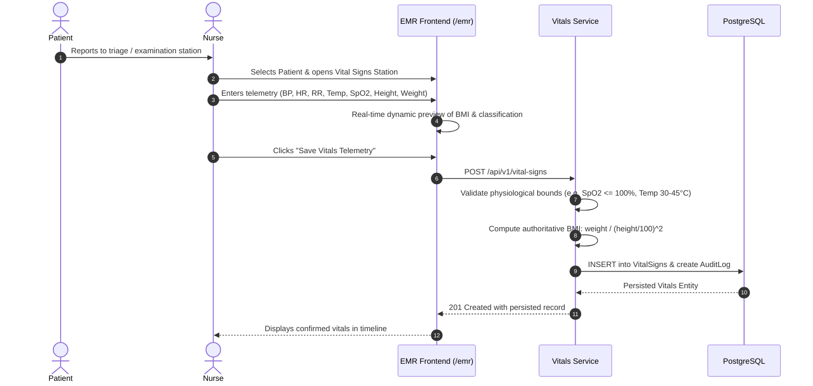
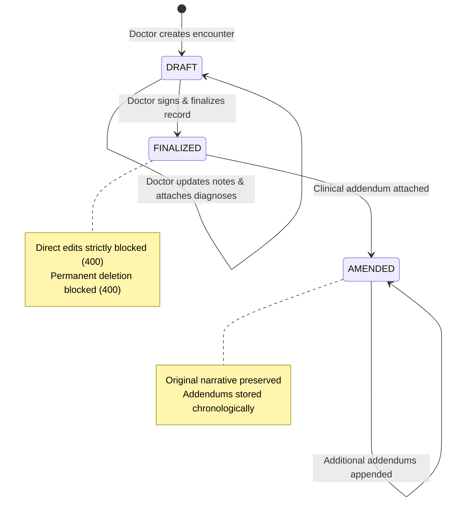

# MedCore HMS — Phase 5 Clinical Workflow Documentation
## Standard Operating Procedures for Clinical EMR Operations

This document outlines the clinical workflows, operational safety standards, and legal compliance architecture implemented in MedCore HMS Phase 5.

---

### Workflow 1: Patient Triaging & Vital Signs Telemetry

1. **Patient Identification**: Clinical staff navigates to `/emr`, selects the patient, and reviews prior baseline telemetry.
2. **Telemetry Capture**: The nurse measures systolic/diastolic blood pressure (mmHg), pulse rate (bpm), respiratory rate (breaths/min), body temperature (°C), oxygen saturation (SpO2 %), height (cm), and weight (kg).
3. **Automated Calculation & Safety Guardrails**:
   - The UI automatically calculates Body Mass Index: `BMI = kg / m²`.
   - The UI displays color-coded indicators:
     - `BMI < 18.5`: Underweight (Yellow)
     - `18.5 <= BMI < 25.0`: Normal Weight (Green)
     - `25.0 <= BMI < 30.0`: Overweight (Yellow)
     - `BMI >= 30.0`: Obese (Red)
   - The backend validates physiological plausibility to prevent typographical errors (e.g., rejecting systolic BP > 250 mmHg, SpO2 > 100%, or temperature > 45°C).

---

### Workflow 2: Physician Encounter Documentation (SOAP Note)

The MedCore HMS clinical encounter follows the universally recognized **SOAP** (Subjective, Objective, Assessment, Plan) framework:

1. **Initiation (`DRAFT` Status)**:
   - The attending physician creates an encounter via `POST /api/v1/medical-records`.
   - The record is initialized in `DRAFT` status, allowing iterative updates during patient rounds or consultations.
2. **Subjective Documentation**:
   - **Chief Complaint**: Concise statement of symptoms prompting the encounter.
   - **History of Present Illness (HPI)**: Comprehensive narrative detailing onset, duration, character, severity, relieving/exacerbating factors, and prior treatments.
3. **Objective Findings**:
   - **Physical Examination**: Organ-system physical exam findings (HEENT, cardiovascular, respiratory, abdominal, neurological).
   - **Associated Vitals**: Linked vital signs telemetry captured by nursing triage.
4. **Assessment & Diagnostic Coding**:
   - Clinical synthesis and differential diagnosis.
   - Formal ICD-10 diagnostic entries added via `POST /api/v1/diagnoses` (e.g., `I10 - Essential (primary) hypertension`).
5. **Plan & Treatment**:
   - **Interventions**: Orders for laboratory analysis, diagnostic imaging, and medication regimens.
   - **Treatment Plan**: Formal multi-disciplinary care plan established via `POST /api/v1/treatment-plans` with clear therapeutic goals and follow-up intervals.

---

### Workflow 3: Encounter Finalization & Healthcare Immutability

1. **Physician Review**: When the clinical consultation and notes are complete, the physician performs a final review of the chart.
2. **Digital Signing Action**:
   - The physician clicks **"Sign & Finalize Record"** in `/emr`.
   - The backend executes `POST /api/v1/medical-records/:id/sign`.
   - The record status transitions atomically from `DRAFT` to `FINALIZED`.
   - The database records `signedAt = CURRENT_TIMESTAMP` and `signedById = user.id`.
   - An immutable `AuditLog` entry is written with action `STATUS_CHANGE`.
3. **Enforcement of Healthcare Immutability**:
   - **Direct Edit Rejection**: Any subsequent `PATCH /api/v1/medical-records/:id` is rejected with `400 Bad Request`.
   - **Direct Diagnosis Addition Rejection**: Attempting to add diagnoses directly to a finalized encounter via `POST /api/v1/diagnoses` is rejected with `400 Bad Request`.
   - **Legal Deletion Prohibition**: In accordance with international healthcare privacy and record retention legislation (e.g., HIPAA, EHR Standards), `DELETE /api/v1/medical-records/:id` is rejected with `400 Bad Request` regardless of user role.

---

### Workflow 4: The Clinical Amendment Workflow

In medical practice, late-arriving diagnostic results (e.g., biopsies, culture sensitivities), diagnostic refinements, or retrospective corrections must be recorded without erasing or obscuring the original historical record.

1. **Amendment Request**:
   - A licensed physician navigates to a finalized or amended encounter.
   - The physician selects **"Add Clinical Amendment"**.
2. **Documenting the Addendum**:
   - **Amendment Reason**: Documented justification (e.g., *"Late-arriving pathology report confirmed benign thyroid adenoma"*).
   - **Addendum Notes**: Clinical addendum clarifying the revised findings, altered prognosis, or modified therapeutic course.
3. **Append-Only Addendum Storage**:
   - The system calls `POST /api/v1/medical-records/:id/amend`.
   - The parent record's status transitions to `AMENDED`.
   - An immutable record is inserted into `MedicalRecordAmendment` capturing:
     - `medicalRecordId`: Reference to the encounter.
     - `amendedById`: Attending physician user ID.
     - `amendedAt`: Cryptographic timestamp of amendment.
     - `amendmentReason`: Clinical rationale.
     - `addendumNotes`: Substantive addendum text.
   - The original `chiefComplaint`, `physicalExamination`, `assessment`, and `plan` remain 100% unaltered.
4. **Auditability**:
   - When the chart is rendered in the EMR or printed for legal/insurance purposes, all amendments are presented chronologically below the original signed narrative, complete with timestamps and author signatures.

---

### Workflow 5: Patient Safety Protocols (Allergies & Medication History)

1. **Allergy Profiling**:
   - Documented before any pharmacological order or interventional procedure.
   - Clinical staff records allergen name, type (`DRUG`, `FOOD`, `ENVIRONMENTAL`, `OTHER`), and severity (`MILD`, `MODERATE`, `SEVERE`, `LIFE_THREATENING`).
   - Known clinical reactions (e.g., anaphylaxis, angioedema, urticaria) are cataloged.
   - Active allergies appear prominently in red across the Patient 360° overview and clinical chart.
2. **Medication Reconciliation**:
   - Captures active outpatient prescriptions, past therapies, dosages, administration routes, and prescribing clinicians.
   - When medications are stopped or altered, clinical staff updates the record to `isActive: false` and logs the `discontinuedDate` to maintain a faithful pharmacotherapy timeline.
