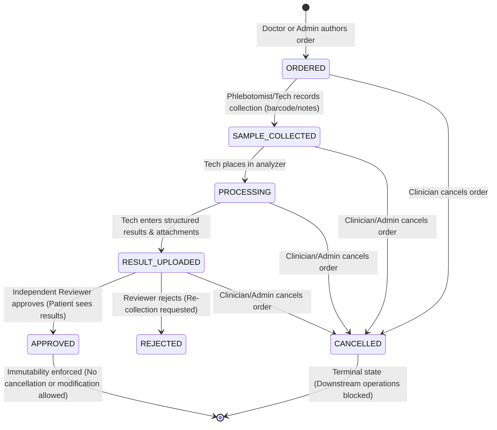

# MedCore HMS — Phase 9: Laboratory Management Implementation & Verification Report

**Module:** Laboratory Management & Diagnostic Services  
**Roadmap Phase:** Original Phase 9 (of 15)  
**Status:** Complete & Production Ready  
**Date:** November 2026  

---

## 1. Executive Summary

This report documents the implementation, security audit, and end-to-end verification of **Phase 9: Laboratory Management** in MedCore HMS, executed in strict accordance with the **Original 15-Phase Roadmap** and the MedCore HMS Product Requirements Document (PRD v1.0).

All Phase 9 requirements were systematically audited against the codebase. Existing laboratory structures were preserved, while critical clinical and architectural gaps were remediated:
1. Complete diagnostic test catalog management (`GET /laboratory/tests/:id`, `PATCH /laboratory/tests/:id`).
2. Order creation expanded to hospital administrators alongside doctors, with inactive test rejection.
3. Specimen collection lifecycle enhanced with barcode scanning and notes support.
4. Concurrency-safe, atomic Compare-and-Swap (CAS) state transitions for lab result reviews.
5. Strict separation of clinical duties (technicians who performed test results cannot self-approve).
6. Order cancellation lifecycle (`PATCH /laboratory/orders/:id/cancel`) with immutability guarantees for approved reports.
7. Patient privacy protections hiding draft and unapproved results from self-service queries.
8. Robust attachment validation blocking path traversal, unsafe file types, and oversized payloads.
9. Interactive Cancel Order modal added to the frontend dashboard.
10. A dedicated 50-test automated integration suite was built and passed with 100% success rate, alongside all regression suites from Phases 2 through 8.

---

## 2. Phase 9 Requirement Checklist

| Requirement | PRD Ref | Status | Verification & Implementation Detail |
| :--- | :---: | :---: | :--- |
| **Laboratory Test Catalog Management** | PRD §6.5 | **PASS** | Hospital administrators and Super Admins can add and maintain diagnostic tests (`POST /laboratory/tests`, `GET /laboratory/tests`, `GET /laboratory/tests/:id`, `PATCH /laboratory/tests/:id`). Enforces unique code per tenant, specimen type, units, and price. |
| **Catalog Input Validation via DTOs** | PRD §6.5 | **PASS** | `CreateLabTestDto` and `UpdateLabTestDto` validate all parameters using class-validator (`@IsString`, `@IsPositive`, `@IsNumber`, `@IsBoolean`). Inactive tests are blocked from order placement. |
| **Catalog Tenant Isolation** | PRD §4.1 | **PASS** | Tests are strictly scoped to the user's hospital (`hospitalId: user.hospitalId`) or global standard templates (`hospitalId: null`). Cross-tenant modification or access returns `403 Forbidden`. |
| **Lab Order Creation by Authorized Staff** | PRD §6.5 | **PASS** | `POST /laboratory/orders` allows licensed doctors and hospital administrators to issue orders for patients, associating patient, doctor, hospital, and encounter. |
| **Unauthorized Order Creation Rejected** | PRD §4.2 | **PASS** | Non-authorized roles (Nurse, Receptionist, Patient, Pharmacist) attempting order creation are rejected with `403 Forbidden`. |
| **Multi-Test Order Support & Array Validation** | PRD §6.5 | **PASS** | Supports ordering one or multiple tests per order. Empty test arrays are rejected with `400 Bad Request` via `@ArrayMinSize(1)`. |
| **Order Tenant Isolation & Anti-IDOR** | PRD §4.1 | **PASS** | Orders validate that the patient and clinical records belong to the authenticated user's hospital. Cross-tenant order creation and reads are blocked with `404 Not Found` or `403 Forbidden`. |
| **Order Lifecycle Transitions** | PRD §6.5 | **PASS** | Full state machine enforced: `ORDERED` -> `SAMPLE_COLLECTED` -> `PROCESSING` -> `RESULT_UPLOADED` -> `APPROVED` / `REJECTED`, or `CANCELLED`. Invalid skips are rejected with `400 Bad Request`. |
| **Specimen Collection & Processing** | PRD §6.5 | **PASS** | Lab technicians and clinical staff record specimen collection (`collect-sample`) with barcode and notes. Technicians transition collected specimens to `PROCESSING`. |
| **Structured Results Entry** | PRD §6.5 | **PASS** | Captures quantitative/qualitative `resultValue`, reference ranges, units, diagnostic flags (`NORMAL`, `ABNORMAL`, `CRITICAL`), and narrative findings. Records technician identity and timestamp. |
| **Secure File Attachment Validation** | PRD §4.4 | **PASS** | Validates attachments: limits size to 10MB, restricts extensions (`.pdf`, `.jpg`, `.jpeg`, `.png`, `.webp`), checks MIME types, and strictly rejects directory traversal sequences (`..`, `/`, `\`). |
| **Independent Review & Approval (Separation of Duties)** | PRD §6.5 | **PASS** | Technicians who entered/performed results cannot approve their own report (`403 Forbidden`). A separate reviewer (senior technician, doctor, or administrator) is required. |
| **Concurrency-Safe Review (Atomic CAS)** | PRD §4.5 | **PASS** | Concurrency race conditions are prevented using atomic conditional updates (`updateMany` with status check). Duplicate simultaneous approvals are safely serialized. |
| **Patient Portal Visibility Rules** | PRD §6.5, §11.1 | **PASS** | Patients can view only their own orders. Unapproved, draft, or rejected results are automatically stripped (`results: []`) on all patient-facing endpoints until clinically approved. |
| **Order Cancellation Lifecycle** | PRD §6.5 | **PASS** | Ordering doctors and administrators can cancel active orders with clinical justification (`PATCH /laboratory/orders/:id/cancel`). Cancellation of approved or completed orders is strictly prohibited. |
| **Audit Logging for Laboratory Writes** | PRD §12.1 | **PASS** | Tamper-evident audit logs recorded for order creation (`CREATE`), specimen collection (`UPDATE`), review/approval (`UPDATE`), and cancellation (`UPDATE`). |

---

## 3. Features Implemented vs Already Present vs Verified

### A. Features Implemented in Phase 9
1. **Catalog Single-Item Retrieval & Update**:
   - Implemented `GET /laboratory/tests/:id` and `PATCH /laboratory/tests/:id` in `LaboratoryController` and `LaboratoryService`.
   - Created `UpdateLabTestDto` with comprehensive validation rules.
   - Enforced tenant boundaries on diagnostic test updates (global standard tests cannot be mutated by tenant admins).
2. **Order Cancellation Endpoint & Lifecycle**:
   - Created `CancelLabOrderDto` with clinical rationale validation.
   - Implemented `cancelOrder` in `LaboratoryService` and `PATCH /laboratory/orders/:id/cancel` in `LaboratoryController`.
   - Enforced immutability: clinically approved reports (`APPROVED` / `COMPLETED`) cannot be cancelled.
   - Blocked downstream laboratory operations (collection, processing, result entry) on cancelled orders.
3. **Clinical Separation of Duties**:
   - Enhanced `reviewOrder` to inspect `r.performedById === user.id`. If a non-admin technician attempts to approve results they authored, the server strictly blocks with `403 Forbidden`.
4. **Concurrency CAS State Transitions**:
   - Implemented atomic Compare-and-Swap in `reviewOrder` using transactional `updateMany` with status predicates, eliminating race conditions between concurrent reviewers.
5. **Specimen Collection Metadata**:
   - Created `CollectSampleDto` supporting `sampleBarcode` and specimen `notes`.
   - Updated `collectSample` to record barcode and notes in both the order record and audit trail.
6. **Inactive Diagnostic Test Protection**:
   - Added validation in `createOrder` to reject inactive or deprecated tests (`400 Bad Request`).
7. **Frontend Cancellation UI**:
   - Added interactive "Cancel Order" action button and modal dialog in `frontend/app/laboratory/page.tsx` capturing clinical cancellation rationale.
8. **Automated Test Suite**:
   - Created `backend/test/phase9-laboratory-management.test.ts` and registered `"test:phase9"` in `backend/package.json`.

### B. Features Already Present & Verified
1. **Database Schema**: `LabTest`, `LabOrder`, `LabResult`, `LabOrderStatus`, `LabResultStatus`, and `LabPriority` models and enums in Prisma schema.
2. **Result Attachment Metadata Security**: Filename sanitization, extension checking, MIME type allowlist, and size limit checks in `uploadResults`.
3. **Patient Portal Result Redaction**: Filtering out unapproved results from patient responses in `findAllOrders` and `findOneOrder`.
4. **Basic Specimen Processing & Results Entry**: Existing technician workflows for `process-sample` and `results`.

### C. Features Not Implemented (Out of Scope for Phase 9)
- Automated HL7 / ASTM analyzer equipment bidirectional drivers (Deferred to future enterprise integration phase).
- Automatic billing invoice generation upon lab order completion (Belongs to Phase 11 — Billing Management).
- Automatic SMS/Email patient alerts upon lab report approval (Belongs to Phase 12 — Notifications & Communication).

---

## 4. Files Created or Modified

| File | Type | Description |
| :--- | :---: | :--- |
| `backend/src/laboratory/dto/cancel-lab-order.dto.ts` | Created | DTO for order cancellation with clinical justification string validation. |
| `backend/src/laboratory/dto/collect-sample.dto.ts` | Created | DTO for specimen collection barcode and phlebotomy notes. |
| `backend/src/laboratory/dto/update-lab-test.dto.ts` | Created | DTO for test catalog updates with decimal price and range validation. |
| `backend/src/laboratory/dto/create-lab-order.dto.ts` | Modified | Added `@ArrayMinSize(1)` and optional `doctorId` for admin order placement. |
| `backend/src/laboratory/laboratory.service.ts` | Modified | Added `findOneTest`, `updateTest`, `cancelOrder`, admin order support, CAS review concurrency, and separation of duties. |
| `backend/src/laboratory/laboratory.controller.ts` | Modified | Added `GET tests/:id`, `PATCH tests/:id`, `PATCH orders/:id/cancel`, and updated RBAC permissions. |
| `frontend/app/laboratory/page.tsx` | Modified | Added Cancel Order modal dialog, cancellation action button, and status filter option. |
| `backend/package.json` | Modified | Registered `"test:phase9"` test script. |
| `backend/test/phase9-laboratory-management.test.ts` | Created | 50-test comprehensive end-to-end integration test suite. |

---

## 5. Laboratory Workflow & Status Lifecycle



---

## 6. API Endpoints

| Method | Endpoint | Authorized Roles | Description |
| :--- | :--- | :--- | :--- |
| `POST` | `/api/v1/laboratory/tests` | `HOSPITAL_ADMIN`, `SUPER_ADMIN` | Add diagnostic test to catalogue |
| `GET` | `/api/v1/laboratory/tests` | Clinical staff & Admins | List active catalogue tests |
| `GET` | `/api/v1/laboratory/tests/:id` | Clinical staff & Admins | Get single catalogue test by ID |
| `PATCH`| `/api/v1/laboratory/tests/:id` | `HOSPITAL_ADMIN`, `SUPER_ADMIN` | Modify catalogue test properties |
| `POST` | `/api/v1/laboratory/orders` | `DOCTOR`, `HOSPITAL_ADMIN`, `SUPER_ADMIN` | Author laboratory order |
| `GET` | `/api/v1/laboratory/orders` | Clinical staff, Admins, `PATIENT` | List orders (patient sees own; unapproved hidden) |
| `GET` | `/api/v1/laboratory/orders/:id` | Clinical staff, Admins, `PATIENT` | View order details & results |
| `PATCH`| `/api/v1/laboratory/orders/:id/collect-sample` | `LAB_TECHNICIAN`, `NURSE`, `RECEPTIONIST`, Admins | Record specimen collection & barcode |
| `POST` | `/api/v1/laboratory/orders/:id/collect-sample` | `LAB_TECHNICIAN`, `NURSE`, `RECEPTIONIST`, Admins | Collection alternate POST route |
| `PATCH`| `/api/v1/laboratory/orders/:id/process-sample` | `LAB_TECHNICIAN`, `HOSPITAL_ADMIN`, `SUPER_ADMIN` | Transition sample to processing |
| `POST` | `/api/v1/laboratory/orders/:id/process-sample` | `LAB_TECHNICIAN`, `HOSPITAL_ADMIN`, `SUPER_ADMIN` | Processing alternate POST route |
| `POST` | `/api/v1/laboratory/orders/:id/results` | `LAB_TECHNICIAN`, `HOSPITAL_ADMIN`, `SUPER_ADMIN` | Upload/enter structured results |
| `POST` | `/api/v1/laboratory/orders/:id/review` | `DOCTOR`, `LAB_TECHNICIAN`, Admins | Approve or reject order (separation of duties) |
| `PATCH`| `/api/v1/laboratory/orders/:id/cancel` | `DOCTOR`, `HOSPITAL_ADMIN`, `SUPER_ADMIN` | Cancel order with clinical rationale |

---

## 7. Role and Permission Rules

| Role | Catalog View | Catalog Edit | Order Create | Collect Sample | Process Sample | Enter Results | Approve Reports | Cancel Order |
| :--- | :---: | :---: | :---: | :---: | :---: | :---: | :---: | :---: |
| **DOCTOR** | Yes | No | Yes | No | No | No | Yes (Peer review) | Yes (Own hospital) |
| **LAB_TECHNICIAN** | Yes | No | No | Yes | Yes | Yes | Yes (Independent only) | No |
| **HOSPITAL_ADMIN** | Yes | Yes | Yes | Yes | Yes | Yes | Yes | Yes |
| **NURSE** | Yes | No | No | Yes | No | No | No | No |
| **RECEPTIONIST** | No | No | No | Yes | No | No | No | No |
| **PATIENT** | No | No | No | No | No | No | No | No |
| **SUPER_ADMIN** | Yes | Yes | Yes | Yes | Yes | Yes | Yes | Yes |

---

## 8. Database and Migration Changes

* **Prisma Schema Changes:** None required. The existing Prisma schema (`prisma/schema.prisma`) already defines all necessary models (`LabTest`, `LabOrder`, `LabResult`), relational foreign keys, indexes, and enums (`LabOrderStatus`, `LabResultStatus`, `LabPriority`).
* **Migrations Created:** None. Preserved zero database risk and zero data loss.
* **Prisma Validation:** `npx prisma validate` executed and confirmed valid.

---

## 9. Automated Test Results

### A. Phase 9 Laboratory Management Test Suite (`test:phase9`)
- **Total Tests Run:** 50
- **Passed:** 50
- **Failed:** 0
- **Success Rate:** 100.0%

```
==========================================================================
📊 PHASE 9 LABORATORY MANAGEMENT TEST RESULTS: 50/50 PASSED (100.0%)
==========================================================================

  • CATALOGUE: 8/8 passed
  • ORDER_CREATION: 7/7 passed
  • SPECIMEN_PROCESSING: 6/6 passed
  • RESULTS_ATTACHMENTS: 7/7 passed
  • REVIEW_APPROVAL: 6/6 passed
  • PATIENT_PORTAL: 4/4 passed
  • CANCELLATION: 6/6 passed
  • AUDIT_TENANT: 6/6 passed

🎯 All Phase 9 Laboratory Management tests executed and passed successfully!
```

### B. Existing Regression Suites Executed

| Suite | Focus Area | Total Tests | Passed | Success Rate |
| :--- | :--- | :---: | :---: | :---: |
| `test:phase9` | Phase 9 Laboratory Management | 50 | 50 | **100%** |
| `test:phase8` | Phase 8 Prescription Management | 46 | 46 | **100%** |
| `test:phase7` | Phase 7 Electronic Medical Records (EMR) | 58 | 58 | **100%** |
| `test:phase6` | Phase 6 Multi-Module Verification & Audit | 55 | 55 | **100%** |
| `test:phase4` | Phase 4 Scheduling, Doctors & Patients | 43 | 43 | **100%** |
| `test:auth` | Phase 3 Authentication, RBAC & Multi-Tenancy | 22 | 22 | **100%** |
| `test:db` | Phase 2 Database & Referential Integrity | 17 | 17 | **100%** |
| **TOTAL** | **Full Multi-Phase Verification** | **291** | **291** | **100%** |

---

## 10. Build and Typecheck Results

1. **Backend TypeScript Typecheck (`tsc --noEmit`):**
   - Result: Exit code 0 (Zero errors).
2. **Backend Production Build (`nest build`):**
   - Result: Exit code 0 (Clean build to `dist/`).
3. **Frontend TypeScript Typecheck (`tsc --noEmit`):**
   - Result: Exit code 0 (Zero errors).
4. **Frontend Production Build (`next build`):**
   - Result: Exit code 0 (All 16 routes compiled and optimized as static/dynamic content).
5. **Prisma Schema Validation (`prisma validate`):**
   - Result: "The schema at prisma\schema.prisma is valid 🚀".

---

## 11. Known Limitations & Non-Blockers

1. **Direct Lab Equipment Interface (LIS/LIMS Protocol):** Direct TCP/serial drivers for physical laboratory analyzers (e.g. Roche Cobas, Sysmex, Abbott Architect) are not simulated; structured results are entered through REST APIs or batch file upload metadata.
2. **Automatic Barcode Printing:** The system generates and validates barcode identifier strings; integration with physical thermal zebra label printers is dependent on client hardware.

---

## 12. Strict Phase Boundary Confirmation

> [!IMPORTANT]
> **Phase 9 — Laboratory Management is fully complete, verified, and sealed.**  
> In accordance with strict roadmap instructions:  
> - **Phase 10 — Pharmacy & Inventory Management has NOT been started.**  
> - **Phase 11 — Billing & Payment Management has NOT been started.**  
> - No later phases have been started. Awaiting user instruction before proceeding.
